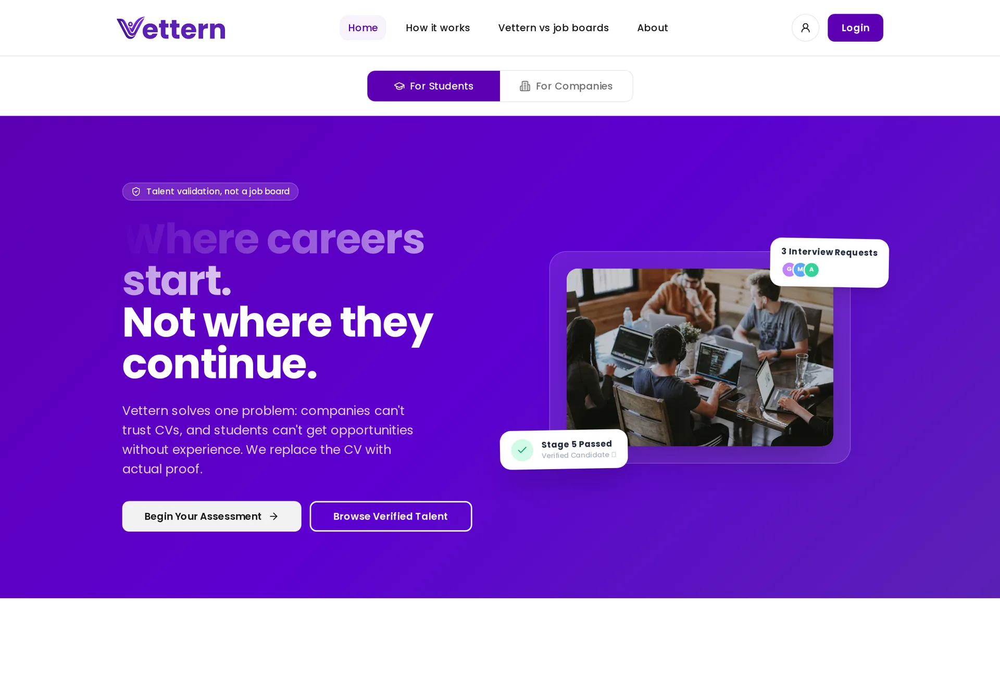
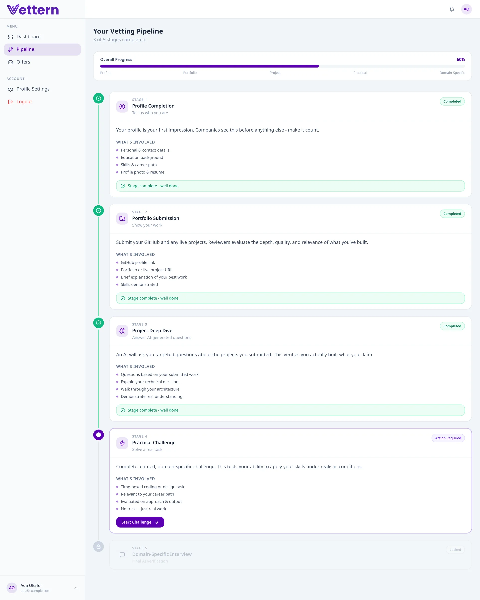
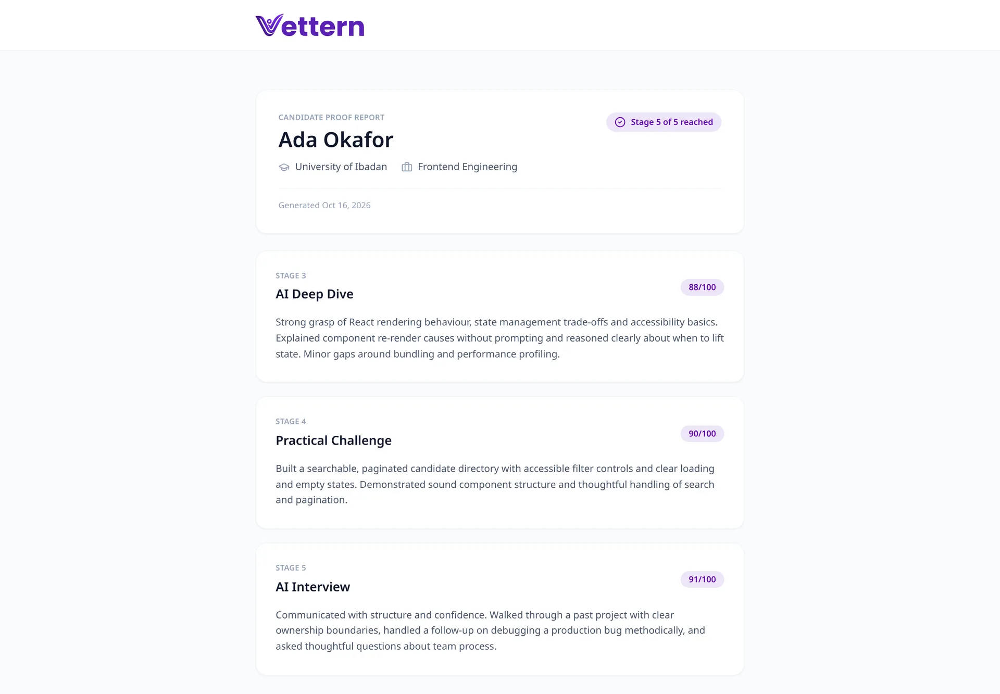

# Vettern (formerly InternConnect)

**Talent validation, not a job board.** Vettern replaces the CV with proof: a 5-stage, AI-assisted assessment pipeline that helps Nigerian companies discover and vet early-career talent.

🔗 **Live:** [internconnect.pro](https://internconnect.pro) *(swap to vettern.pro once it's live)*
👤 **My role:** Solo developer (backend, frontend, AI integration)
📍 **Status:** Live in Nigeria, actively shipping
🔒 **Source code:** Private. Happy to walk through it on a call.

## The problem
Companies get hundreds of applications per role and most CVs look the same on paper. Skilled juniors get filtered out because a résumé can't prove what they can do.

## The idea
A job board asks *"who wants this job?"* Vettern asks *"who can actually do this job?"*
Students are free forever. Companies pay 10% of the intern's monthly stipend, off-platform, only once they hire someone.

## The 5-stage vetting pipeline
| Stage | What happens |
|---|---|
| 1. Profile | Skills, education and experience |
| 2. Portfolio submission | GitHub, projects and certifications, reviewed by AI, with an identity check and full attempt history |
| 3. Project deep dive | Fullscreen, screen-monitored. AI asks questions generated from the candidate's *own* projects to verify they built what they claim. Results emailed via Resend |
| 4. Practical challenge | A real task tied to the candidate's role, scored with AI feedback |
| 5. Domain interview | A final AI interview specific to the candidate's domain |

Stage 3 is the one I'm proudest of. "Why Django over Flask here?" is much harder to bluff than a multiple-choice quiz.

## What I built
- The full 5-stage assessment flow, with attempt history stored for every stage
- AI-generated questions and feedback through the Groq API
- Assessment-integrity controls (fullscreen and screen monitoring)
- Auth: Google OAuth, email OTP, password reset
- Transactional result emails with Resend
- Candidate proof reports for companies

## Tech stack
Django · React + Vite · PostgreSQL · Groq API · Resend · Cloudinary · Whitenoise · Render

## Challenges and what I learned
<!-- Add 2-3 honest points in your own words. Examples to consider:
- How you stopped candidates from gaming the AI questions
- How you structured attempt history so retakes stay auditable
- Handling slow/unreliable networks for timed assessments in Nigeria -->

## Numbers
<!-- Only add real figures: registered candidates, completed assessments, companies. If you have none yet, delete this section. -->

*Candidate names and scores in screenshots are fictional demo data.*

---
[Portfolio case study](https://danieliyendo.netlify.app/portfolio-vettern) · [All my work](https://github.com/iyendodaniel) · iyendodaniel4@gmail.com
